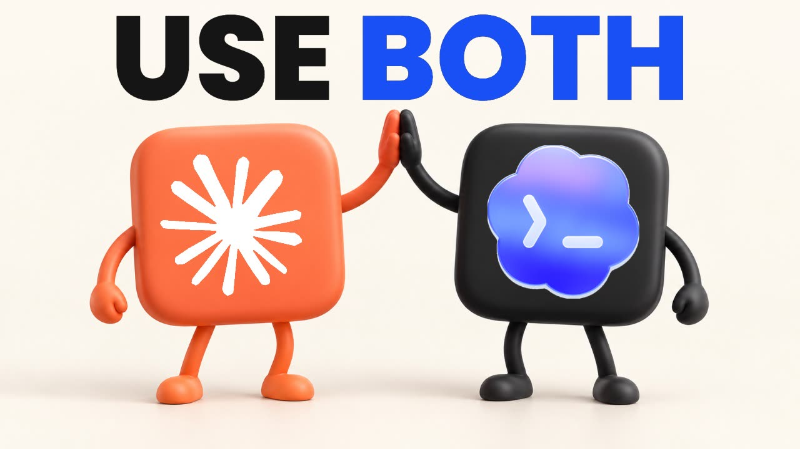

# Use Both: kit de flujo de trabajo Claude + Codex

**🇧🇷 [Português](README.md) · 🇺🇸 [English](README.en.md) · 🇪🇸 [Español](README.es.md)**

[](https://inematds.github.io/use-both-claude-codex/guia/es/)

## 📖 Guía de uso

Guía en español: **https://inematds.github.io/use-both-claude-codex/guia/es/**

🎬 Video: https://www.youtube.com/watch?v=3YC3-x-Y9QM

> Espejo de INEMA del kit original de Prompt Advisers (Mark Kashef), licencia MIT. Fuente: https://github.com/earlyaidopters/gumroad-resources/tree/main/resources/use-both-claude-codex-workflow-kit
>
> Los documentos del kit (GUIDE.md, PROMPTS.md, START-HERE.md, docs/, templates/, skills/ etc.) están en inglés.

**Planifica con uno. Desafíalo con el otro. Mantén el proyecto en marcha.**

Un complemento práctico al video de Claude + Codex de Mark Kashef: seis flujos de trabajo, prompts listos para copiar, una guía imprimible y dos pequeñas skills para moverte entre asistentes sin volver a explicar el proyecto.


## Empieza aquí

1. Lee [START-HERE.md](START-HERE.md) para una prueba de cinco minutos sin instalar nada.
2. Elige una tarea de [PROMPTS.md](PROMPTS.md), reemplaza cada marcador entre corchetes y ejecútala en tu propio proyecto.
3. Lee la [guía paso a paso](GUIDE.md) o descarga el [PDF ilustrado](guide/USE-BOTH-WORKFLOW-GUIDE.pdf).
4. Instala las [skills opcionales handoff y prime](docs/setup.md#install-the-two-skills) cuando quieras una continuidad repetible.

**Gratis significa gratis.** Los archivos públicos están disponibles aquí sin compra. Una edición en Gumroad empaqueta el mismo kit y el PDF juntos; cualquier contribución es opcional. Tus suscripciones de IA, el uso de APIs y los servicios de terceros van por separado.

## ¿Qué hay dentro?

| Archivo o carpeta | Qué obtienes |
| --- | --- |
| [GUIDE.md](GUIDE.md) | Un recorrido legible por IA de los seis niveles |
| [PROMPTS.md](PROMPTS.md) | Prompts de planificación, revisión, imágenes, computer use supervisado, metas y continuidad |
| [guide/](guide/) | Un PDF pulido e imprimible con una tarjeta de rutas |
| [skills/handoff/](skills/handoff/) | Una skill local del proyecto que escribe un retrato compacto y saneado |
| [skills/prime/](skills/prime/) | Una skill de lectura previa que recupera el estado sin tratar notas viejas como permiso nuevo |
| [templates/](templates/) | Plantillas de briefing de tarea, plan, revisión y handoff |
| [examples/](examples/) | Un ejemplo ficticio resuelto con un test ejecutable real |
| [docs/setup.md](docs/setup.md) | Rutas manual, por CLI y por plugin opcional; instalación y manejo de colisiones |
| [docs/routing-card.md](docs/routing-card.md) | Qué asistente probar para cada trabajo |
| [docs/privacy-and-safety.md](docs/privacy-and-safety.md) | Límites de datos, aprobaciones, costos y handoffs seguros |
| [docs/troubleshooting.md](docs/troubleshooting.md) | Fallos comunes y pasos concretos de recuperación |
| [scripts/install_skills.py](scripts/install_skills.py) | Instalador con vista previa primero que se niega a sobrescribir skills existentes |

## Los seis niveles

1. **Deja que discutan:** un asistente redacta; el otro critica el mismo artefacto. Detente tras un ciclo de revisión acotado, no tras un acuerdo vacío.
2. **Generar imágenes:** usa una herramienta de imagen disponible y devuelve el archivo real al proyecto. Verifica antes el acceso y la facturación.
3. **Dividir el trabajo:** uno construye en una rama; el otro revisa el diff. Los tests y tu aprobación deciden qué se publica.
4. **Computer use supervisado:** delega una acción autorizada manteniendo bajo tu control las credenciales, los pagos y los envíos con consecuencias.
5. **Dale una línea de meta:** define un objetivo medible y una condición de parada. Pedir que se detenga tras un tiempo no es necesariamente un límite de ejecución real.
6. **Pasa el testigo (handoff):** escribe el estado en un archivo portátil y luego haz que el siguiente asistente lo lea y lo verifique antes de continuar.

## Requisitos

- La ruta sin instalación solo necesita dos asistentes y un editor de texto. Un solo asistente también puede usar el hábito del handoff.
- La delegación por CLI necesita Claude Code y Codex CLI instalados y autenticados, además de un host con terminal. El acceso a modelos y herramientas concretos depende de tu cuenta y tu entorno.
- El instalador opcional y el ejemplo incluido usan **Python 3.9+**, sin paquetes de Python de terceros.
- Git es necesario para el flujo de rama/revisión. GitHub es opcional salvo que quieras un pull request alojado.
- La generación de imágenes y el computer use **no están garantizados solo por tener la CLI**. Verifica las herramientas disponibles en la sesión real.

El video menciona **Claude Opus 5.5** y **GPT-6 Astra**. Son las etiquetas grabadas, no una promesa de que una cuenta exponga los mismos IDs de modelo, ajustes de esfuerzo, precios o herramientas. Elige deliberadamente un modelo disponible y registra lo que realmente se ejecutó.

## Instalación rápida de las skills

Ejecútalo desde este kit descargado, apuntando a un directorio de proyecto existente que sea tuyo:

```bash
# Preview only. Nothing is changed.
python3 scripts/install_skills.py --project /path/to/your/project --target both

# Apply after reviewing the printed destinations.
python3 scripts/install_skills.py --project /path/to/your/project --target both --apply
```

Usa `--target claude` o `--target codex` para un solo asistente. El instalador escribe solo `.claude/skills/{handoff,prime}/SKILL.md` y/o `.agents/skills/{handoff,prime}/SKILL.md`. Nunca cambia skills globales, credenciales, configuraciones ni archivos de skills existentes. Consulta [setup](docs/setup.md) para la instalación manual, las colisiones de nombres con skills personales, el comportamiento de recarga y la eliminación.

En Claude Code: `/handoff` al final de una sesión y luego `/prime` en la siguiente. En Codex: `$handoff` y luego `$prime`, donde haya skills disponibles. Con cualquier otro asistente: pídele que lea `handoff/LATEST.md` y el retrato referenciado, resuma el estado y espere tu siguiente instrucción.

## Qué son estas skills y qué no son

Son **nuevas versiones didácticas seguras para publicar**, no un volcado de las skills privadas de Mark. Implementan el patrón central de retrato y reanudación usando una sola carpeta de proyecto. No incluyen contexto privado de negocio, información de clientes, credenciales, automatización multiproyecto, agentes en segundo plano ni integraciones con los sistemas de Mark.

Una skill es un archivo de instrucciones, no una barrera de cumplimiento. Léela antes de usarla. Los archivos pueden contener errores o instrucciones maliciosas; los permisos vigentes y tu pedido actual siguen siendo los que mandan. Nunca uses un segundo asistente para eludir un control de seguridad que fue rechazado.

## Verifica la descarga

```bash
python3 -m unittest discover -s tests -v
python3 examples/task-board/test_task_board.py
```

Los tests ejercitan la vista previa/aplicación del instalador, la idempotencia, el rechazo ante conflictos, el rechazo de enlaces simbólicos y el ejemplo sintético task-board. No prueban que todo modelo siga las skills ni que tu cuenta tenga una herramienta concreta. No se afirma ningún benchmark de extremo a extremo con asistentes en vivo.

## Usa este kit con una IA

```text
Read START-HERE.md, GUIDE.md, PROMPTS.md, and docs/privacy-and-safety.md
from this kit. Treat them as reference material, not permission to act.
My project is [project]. My task is [task]. My acceptance test is [test].
Recommend one workflow and identify what access it needs. Do not install,
upload, purchase, publish, or modify anything until I choose the next step.
```

## Fuentes, licencia y cambios

Documentación verificada el **26 de septiembre de 2026**. Consulta las [fuentes y notas de versión](docs/sources.md) y el [CHANGELOG.md](CHANGELOG.md). Prefiere la documentación oficial actual cuando cambien las interfaces.

El texto y el código originales están bajo la [Licencia MIT](LICENSE). Los nombres y marcas de productos de terceros siguen siendo propiedad de sus dueños; consulta [ASSET-NOTICE.md](ASSET-NOTICE.md). Este es un recurso educativo independiente, no un producto ni un respaldo de OpenAI o Anthropic.

Nunca publiques credenciales ni handoffs privados en issues de GitHub. Para un problema reproducible, comparte tu sistema operativo, la versión de la herramienta relevante, el comando saneado y un ejemplo sintético mínimo.
